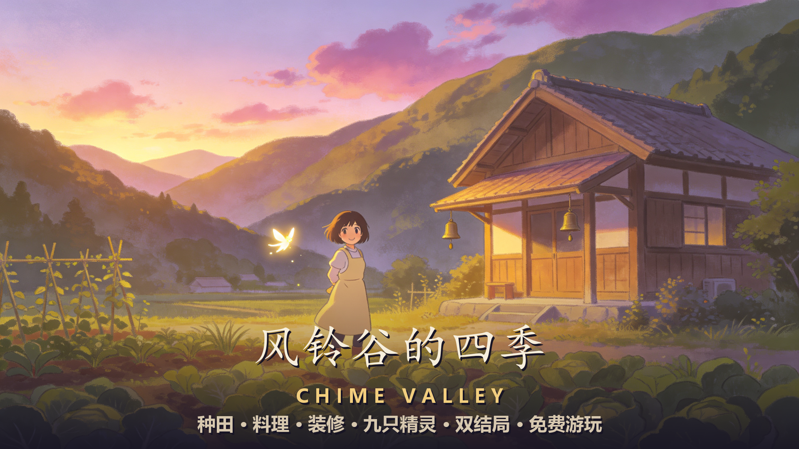

<div align="center">

# 🎐 风铃谷的四季 · Chime Valley

**一款吉卜力画风的女生向治愈系网页游戏**

*点开链接，推开那扇熟悉的木门 —— 山谷的风，正在等你。*

### ▶ 立即游玩：[chime-valley.pages.dev](https://chime-valley.pages.dev/)

### ⭐ 如果喜欢，求一个 Star 支持一下！

[](https://chime-valley.pages.dev/)
[](https://github.com/wangshengithub/chime-valley)

[](#-许可)
[](#%EF%B8%8F-%E6%8A%80%E6%9C%AF)
[](#-游戏特色)



</div>

---

## 💌 写在前面

> 亲爱的竹鹿：
> 
> 风铃谷的老屋，留给你。
> 替我照看好这座房子、那片田园，还有森林里的朋友们。
> 等风铃重新响起来的那天，你就会明白一切。
> 
> —— 奶奶

一年前奶奶离开了。你回到童年度过假期的山谷，推开老屋的门——屋里空空荡荡，只有屋檐下那枚旧风铃，被风吹得喑哑作响。

你决定留下来，住满一年。

这将是怎样的一年呢？

---

## 🌸 这个游戏是什么样的？

想象一下：**宫崎骏的动画 × 《星露谷物语》的田园 × 点开就玩、不用安装的网页**。

它很安静，很温柔，没有任何失败惩罚。你按自己的节奏生活——

### 🌱 田园四季

- **56 个游戏日**，春夏秋冬各 14 天，季节会真实地流转
- 春天种下土豆和胡萝卜，夏天收获蓝莓，秋天是南瓜和向日葵的金色季节，冬天有耐寒的甜菜根
- 翻土、播种、浇水、收获——每个动作都有专属像素动画
- 雨天不用浇水，作物自己喝水；秋天走进密林深处，会遇见雨夜才发光的蘑菇灯

### 🍲 暖胃料理

- **16 道治愈料理**：热可可、蓝莓果酱、莓果蛋糕、南瓜浓汤、蜜烤板栗、奶奶的蜂蜜蛋糕……
- 从田园和森林采集食材，在老屋的灶台烹饪
- 25% 概率触发「大成功！」做出三份
- 把料理送给镇民，好感度悄悄上升

### 🛋️ 布置你的家

- **25 件家具**随心搭配：壁炉、摇椅、秋千椅、石灯笼、许愿风铃……
- 家的温度升到 2 级以上，清晨会有镇民来敲门做客
- 温度越高，客人越常来（lv2=20% → lv5=80%）

### 🔔 九只森林精灵

山谷里住着守护者和它的小伙伴们——

| 精灵      | 相遇                           |
| ------- | ---------------------------- |
| 🎐 叮当   | 住在老屋屋檐的风铃里，第 3 天清晨主动现身，全程陪伴你 |
| 🌰 橡果团子 | 春天的老橡树下，喂它 3 颗橡果             |
| ☁️ 云朵羊  | 夏天晴天，去溪谷抬头看看天                |
| ✨ 萤火虫群  | 夏夜，把体力用完让天黑下来                |
| 🦦 溪水獭  | 修好木桥后常在溪边，送它 3 颗鹅卵石          |
| 🍄 蘑菇灯  | 秋天的密林深处                      |
| 🗿 石头爷爷 | 巨石坡上长满青苔的老面孔，听它讲整座山谷的故事      |
| ❄️ 雪兔   | 冬天的雪夜，山丘花田                   |
| 🦌 铃音   | ……它只在最后出现                    |

每只精灵都有自己的故事，集齐图鉴后它们会来你的田里做客。

### 🏘️ 七位镇民

杂货店的苏婆婆、沉默的木匠岩伯、邮差小飞、面包房的麦琪姐姐、牧场主花花阿姨、旧书铺的顾先生、还有黏人的小女孩豆豆——

每个人身上都有一段小故事等你发现。帮苏婆婆盘点货物、帮小飞找回失联的笔友、陪豆豆搭树屋……好感升满时，他们还会把拿手菜的做法教给你。

### 📖 十二段回忆 & 双结局

散落在山谷各处的信件、旧物、老照片，拼出奶奶不为人知的往事。

- **普通结局《风再起时》**：一年期满，满谷风铃为你送行
- **真结局《风铃传承》**：集齐 12 段回忆 + 6 只精灵羁绊，风铃重新响起的那一刻……

（通关后进入自由模式，季节继续轮转，把图鉴慢慢补完）

---

## 🕹️ 怎么玩？

|         |                                                   |
| ------- | ------------------------------------------------- |
| **操作**  | 鼠标点击走动与互动（手机触屏同样支持）                               |
| **快捷键** | `B` 背包 · `J` 手账图鉴 · `M` 地图 · `Esc` 关闭 · `空格` 推进对话 |
| **时长**  | 一周目约 1~3 小时，自由模式无限续玩                              |
| **难度**  | 零门槛，无失败惩罚，适合任何玩家                                  |

> 💡 **小贴士**：戴上耳机 🎧 —— 每个季节都有自己的主题曲。

---

## 🚀 立即开始

### 在线游玩（推荐）

| 平台                   | 链接                                                       |
| -------------------- | ---------------------------------------------------------- |
| 官方（Cloudflare Pages） | [chime-valley.pages.dev](https://chime-valley.pages.dev/)   |

### 本地运行

纯静态网页，零依赖、无后端、无需安装——

**方法一**：双击 `index.html`，就这样。

**方法二**：起个本地服务器（可选）：

```bash
npx serve .
# 或
python -m http.server 8080
```

存档自动保存在浏览器 localStorage，下次打开继续。

---

## 🛠️ 技术

- 纯 **HTML5 + CSS3 + 原生 JavaScript**——零框架、零构建、零 npm 依赖
- **Canvas 2D** 渲染场景（384×216 逻辑分辨率，整数倍像素缩放）
- DOM UI 层（中文字体排版优化：霞鹜文楷 + 思源宋体）
- localStorage 存档，带版本迁移与损坏兜底
- 双击 `index.html` 即玩，也可部署到任意静态托管

## 🎨 美术与音频

- 像素素材基底：**Sunnyside World**（Daniel Diggle, CC0）
- 10 首治愈系 BGM（四季主题曲 × 4 + 小镇 / 森林 / 夜晚 / 祭典 / 回忆 / 标题）+ 39 个音效
- 全部素材的来源与授权登记于 [`assets/CREDITS.md`](assets/CREDITS.md)

## 📜 许可

- 代码与自创素材：[MIT](LICENSE)（可任意使用、修改、分发，保留版权声明即可）
- 第三方素材（美术 / 音频 / 字体）遵循其原始许可（CC0 / CC-BY / OFL），再分发时须保留 [`assets/CREDITS.md`](assets/CREDITS.md)

---

<div align="center">

**wangshengithub** · [GitHub](https://github.com/wangshengithub)

*风起时，满谷铃声。*

🎐 免费游玩 · 无内购 · 建议耳机

</div>
